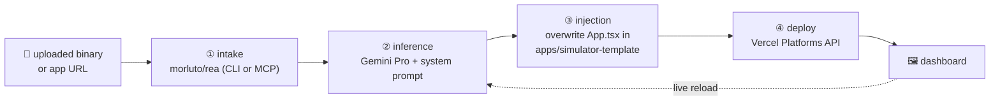

<div align="center">

# ⚡ appbeam

**Host live mobile & desktop apps from any binary.**

Reverse-engineer any app with [REA](https://github.com/morluto/rea), reimagine its
logic as Expo components with **Google Gemini**, and beam it live to **Vercel** —
watch it boot inside a phone frame in your browser.

[](./LICENSE)
[](https://nodejs.org)
[](https://pnpm.io)
[](https://turbo.build)
[](https://modelcontextprotocol.io)

</div>

---

## How it works



| Stage | What happens | Where |
| --- | --- | --- |
| ① **Intake** | The target is fed to `rea analyze` (terminal) or the REA **MCP server** over stdio; the returned evidence layout ships downstream. | `packages/pipeline/src/intake.ts` |
| ② **Inference** | The evidence payload is sent to the Gemini API (`@google/genai`) with a system prompt that converts the logic into a single Expo React Native Web `App.tsx` — and, whenever the evidence shows `fetch`/`axios` endpoints, generates an **in-file mock handler layer** (inline fixtures + a route-matching shim) so cloned UIs never hit dead backends. | `packages/pipeline/src/inference.ts` |
| ③ **Injection** | Gemini's raw output (fences stripped, contract-validated) overwrites `App.tsx` inside `apps/simulator-template` — optionally into a per-run staging copy. | `packages/pipeline/src/inject.ts` |
| ④ **Deployment** | The mutated template is **zipped as an artifact**, pushed to Vercel (inline ≤2.5 MB, else the `/v2/files` upload API), and a production deployment is created + polled to `READY`. | `packages/pipeline/src/vercel.ts` |

The dashboard streams every stage transition over SSE, then loads the returned
`https://*.vercel.app` URL into the device `<iframe>`.

## Monorepo layout

```
appbeam/
├── apps/
│   ├── dashboard/            # Next.js 15 + Tailwind — dropzone, phone frame, SSE UI
│   └── simulator-template/   # blank Expo / React Native Web canvas (pipeline target)
├── packages/
│   └── pipeline/             # orchestration engine (intake → inference → inject → deploy)
├── docker-compose.yml        # one-command environment
├── turbo.json                # task graph: build → dev → typecheck
└── .env.example              # all configuration, documented
```

## Quickstart

**Prerequisites:** Node `>= 22.19`, [pnpm](https://pnpm.io) ≥ 10, and API keys
(fine to leave empty — the pipeline degrades to **mock mode**).

```bash
git clone <your-fork> appbeam && cd appbeam
pnpm install
cp .env.example .env         # add keys (see below)
pnpm dev                     # turbo: builds pipeline, starts dashboard
```

Open **http://localhost:3000**, drop a binary (or paste an app URL), and watch
the four stages run while the phone frame waits for its live URL.

> **Heads up — no keys yet?** Everything still runs: intake falls back to a
> fixture evidence payload, inference returns a canned Expo component, and the
> deployment stage reports `mock` instead of calling Vercel. The config card in
> the dashboard shows exactly which keys are missing.

### Pipeline CLI (no dashboard)

```bash
pnpm run pipeline simulate ./samples/dummy.bin    # tiny fixture for a dry run
pnpm run pipeline simulate ./samples/app.apk
pnpm run pipeline simulate https://example.com --mode real
pnpm run pipeline simulate ./app.bin --json       # JSON-line events
```

### Docker

```bash
cp .env.example .env
docker compose up dashboard                      # http://localhost:3000
docker compose run pipeline simulate /workspace/app.apk   # files from ./samples
```

## Dashboard features

- **Bring your own keys** — the **04 · api configuration** panel stores your
  `GEMINI_API_KEY` / `VERCEL_AUTH_TOKEN` in the browser's `localStorage` and
  sends them as `x-gemini-key` / `x-vercel-token` headers on every request.
  The pipeline prefers client headers and falls back to server `.env` values;
  nothing is persisted server-side.
- **Patch terminal (iterative vibecoding)** — the **05 · patch terminal**
  chat next to the phone frame sends the current `App.tsx` plus a
  natural-language request ("make the theme dark mode") to
  `POST /api/patch-code`; Gemini returns the complete updated file, which is
  re-injected and **redeployed to the same Vercel project** — the iframe
  refreshes against the live URL.
- **API mocking by default** — generated apps intercept recovered
  `fetch`/`axios` calls behind an in-file mock layer, so buttons backed by
  third-party REST endpoints render realistic data instead of failing.
- **Export project** — the nav-bar **⬇ export project** button streams the
  current `apps/simulator-template` (patched `App.tsx` included) as a clean
  `.zip`; unpack it and run `npx expo start` or `npm run web`.

## Configure the Google Gemini API key

1. Open **[Google AI Studio → API keys](https://aistudio.google.com/apikey)**
   and create a key (free tier is enough for demos).
2. Paste it into `.env`:

   ```env
   GEMINI_API_KEY=AIza...
   GEMINI_MODEL=gemini-1.5-pro
   ```

3. **Model note (important):** the pipeline defaults to `gemini-1.5-pro` as
   specified by the platform design, but Google has **retired 1.5 Pro from the
   Gemini developer API** (Vertex AI migration, May 2025). If inference fails
   with `404 model not found`, set `GEMINI_MODEL` to a current Pro model, e.g.
   `gemini-2.5-pro`. The key, endpoint (`@google/genai`), and system prompt stay
   unchanged.

The inference stage truncates oversized evidence at `GEMINI_MAX_PAYLOAD_CHARS`
(default 400 000 chars, head + tail) so REA's multi-hundred-MB dumps can't blow
the context window.

## Configure the Vercel Platforms token

1. Create a token at **[vercel.com/account/tokens](https://vercel.com/account/tokens)**
   with **Full Account** scope (Projects + Deployments are required).
2. Paste it into `.env`:

   ```env
   VERCEL_TOKEN=xxxxx
   VERCEL_TEAM_ID=          # optional: team_xxx / team slug
   VERCEL_PROJECT_NAME=appbeam-preview
   ```

The deployer then, programmatically:

- `POST /v9/projects` — ensures the project exists (Projects API);
- zips the mutated `apps/simulator-template` into `.appbeam/artifacts/*.zip`;
- uploads file entries — inline base64 for ≤2.5 MB, otherwise `POST /v2/files`
  with `x-vercel-digest` SHA-1 references;
- `POST /v13/deployments?forceNew=1&skipAutoDetectionConfirmation=1` with Expo
  build settings (`npx expo export --platform web` → `dist/`);
- polls `GET /v13/deployments/{id}` until `READY` and returns
  `https://<deployment-url>` for the iframe.

> Vercel's REST API accepts **file entries, not a zip blob** (zips travel via
> git integrations), so the zip is kept as a local artifact while the file set
> is pushed by SHA.

## Configure REA (morluto/rea)

```bash
npx -y rea-agents@latest setup     # register the MCP server with your agents
npx -y rea-agents@latest doctor    # verify providers
```

- **`REA_MODE=cli`** (default): the pipeline executes
  `npx -y rea-agents@latest analyze <target>` and captures stdout.
- **`REA_MODE=mcp`**: it spawns the same package as a **stdio MCP server**,
  lists tools, and calls the analysis tool.
- **`REA_MODE=mock`**: fixture payload, no REA install needed.
- Native targets (`.apk/.exe/.elf/…`) need a decompiler provider (Hopper, Ghidra,
  IDA) configured per the [REA docs](https://github.com/morluto/rea). Static
  JavaScript/Electron/.NET analysis works without one. REA runs on the host —
  inside Docker only the lighter analysis paths are available.

Extra flags: `REA_ARGS=--provider ghidra`, `REA_COMMAND=rea` (global install),
`REA_TIMEOUT_MS=600000`.

## Environment reference

| Variable | Default | Purpose |
| --- | --- | --- |
| `PIPELINE_MODE` | `auto` | `auto` (real services when keys exist, mock otherwise) · `real` (fail loudly) · `mock` |
| `GEMINI_API_KEY` | — | Google AI Studio key for inference |
| `GEMINI_MODEL` | `gemini-1.5-pro` | Model id (see retirement note above) |
| `GEMINI_MAX_PAYLOAD_CHARS` | `400000` | Evidence truncation before inference |
| `VERCEL_TOKEN` | — | Master token for Projects + Deployments |
| `VERCEL_TEAM_ID` | — | Optional team scope |
| `VERCEL_PROJECT_NAME` | `appbeam-preview` | Target Vercel project |
| `VERCEL_DEPLOY_TIMEOUT_MS` | `600000` | Poll budget until `READY` |
| `REA_MODE` | `cli` | `cli` · `mcp` · `mock` |
| `REA_COMMAND` | `npx -y rea-agents@latest` | Intake executable |
| `REA_ARGS` | — | Extra args for `rea analyze` |
| `SIMULATOR_TEMPLATE_DIR` | auto | Override the injection target dir |
| `SIMULATOR_ENTRY_FILE` | auto | `App.tsx` → `App.ts` → `App.js` |
| `PIPELINE_STAGING` | unset | `1` = inject into a temp copy (concurrency-safe) |

The pipeline reads the **root `.env`** itself, so keys work identically from
the CLI, Docker, and the Next.js API route (Next only auto-loads
`apps/dashboard/.env*`).

## HTTP API

```bash
# config presence (booleans only — never secrets)
curl http://localhost:3000/api/simulate

# run the pipeline, stream SSE events
curl -X POST http://localhost:3000/api/simulate \
  -F file=@samples/app.apk
# data: {"type":"event","event":{"stage":"intake","status":"running",…}}
# data: {"type":"done","result":{"url":"https://….vercel.app",…}}

# bring your own credentials (override server .env per request)
curl -H "x-gemini-key: AIza…" -H "x-vercel-token: vercel_…" \
  http://localhost:3000/api/simulate

# iterative patch loop: full updated App.tsx + redeploy
curl -X POST http://localhost:3000/api/patch-code \
  -H "Content-Type: application/json" \
  -H "x-gemini-key: AIza…" -H "x-vercel-token: vercel_…" \
  -d '{"code":"…current App.tsx…","request":"make the theme dark mode"}'

# download the generated Expo project as a .zip
curl -OJ http://localhost:3000/api/export
```

## Scripts

| Command | Description |
| --- | --- |
| `pnpm dev` | Turbo: build `pipeline`, then watch + run the dashboard |
| `pnpm build` | Build every workspace (Expo static export included) |
| `pnpm typecheck` | `tsc --noEmit` across all workspaces |
| `pnpm run pipeline …` | Orchestration CLI (`simulate <target>`) |

## Limitations & roadmap

- **Gemini 1.5 Pro retirement** — default model is env-overridable (see above).
- **Shared template file** — in-place injection means concurrent runs collide;
  set `PIPELINE_STAGING=1` for per-run copies (deployments themselves are
  immutable, so Vercel side-effects stay isolated).
- **REA depth** — deep native analysis requires a local provider and, on macOS,
  Hopper/Ghidra/IDA; CI images only cover the static analysis paths.
- **Single-entry injection** — the generated `App.tsx` replaces one file; multi-file
  output (routes/, components/) is on the roadmap.

## License

[MIT](./LICENSE) — go build something weird.
